<picture>
  <source media="(prefers-color-scheme: light)" srcset="docs/media/banner-light.png">
  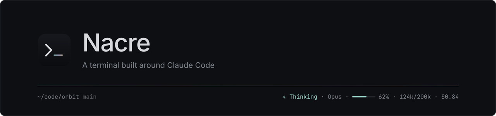
</picture>

<p align="center">
  A desktop terminal for macOS that knows what Claude Code is doing.<br>
  Free, fast, and configurable down to the last shortcut.
</p>

<p align="center">
  <a href="#install">Install</a> ·
  <a href="#claude-code">Claude Code</a> ·
  <a href="#ai-in-the-shell">AI in the shell</a> ·
  <a href="#tabs-and-splits">Tabs and splits</a> ·
  <a href="#shell-integration">Shell integration</a> ·
  <a href="#make-it-yours">Make it yours</a> ·
  <a href="README.fr.md">Français</a>
</p>

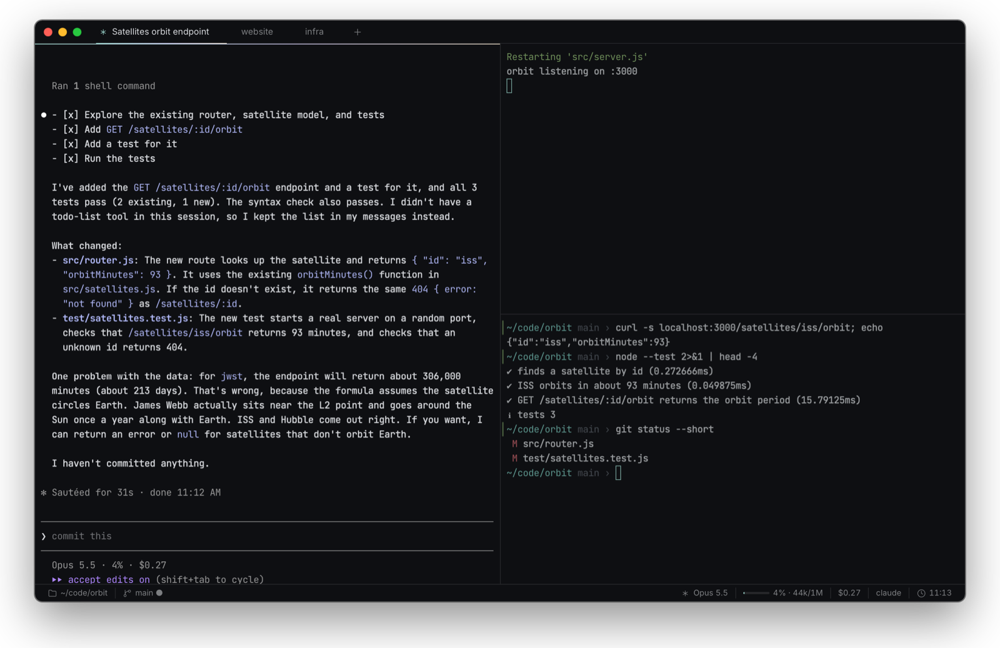

## Claude Code

Run `claude` in any pane. Nacre follows the session and puts what matters in the status bar: state, model, context used, cost, and your 5-hour and weekly limits.

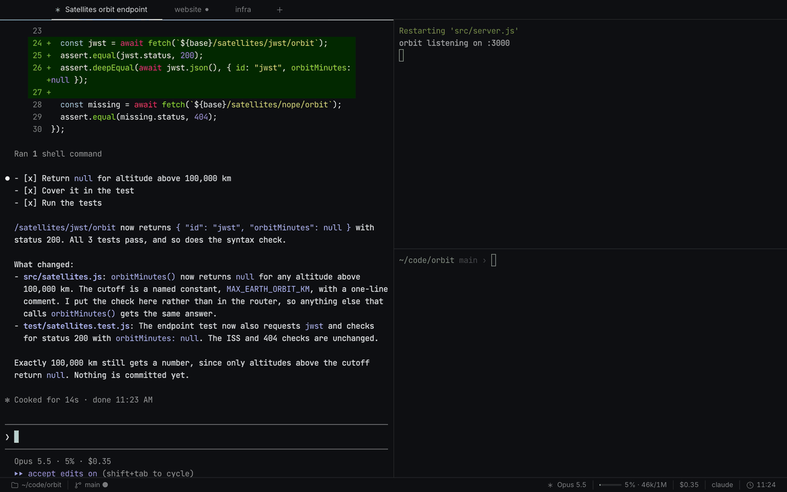

- **A dot on the tab** when Claude is done or waiting for you, a count on the Dock icon, a notification when the pane is out of sight.
- **Sessions** <kbd>⇧⌘C</kbd>: every live session, its context and cost; click one to jump to its pane. **History** resumes any past session. **Usage** shows cost per day, project and model.
- **Panel** <kbd>⌃⌘C</kbd>: files the session changed with their diff, and context over time.
- **Claude in a split** <kbd>⌥⌘C</kbd>.

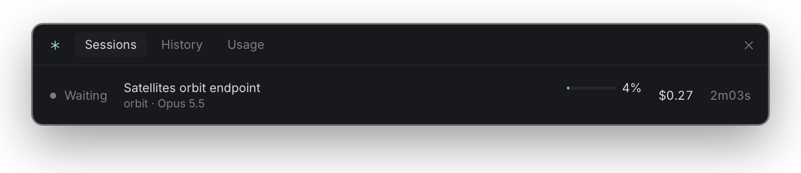
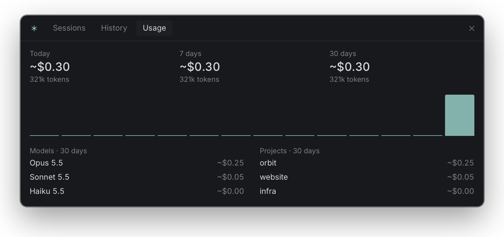
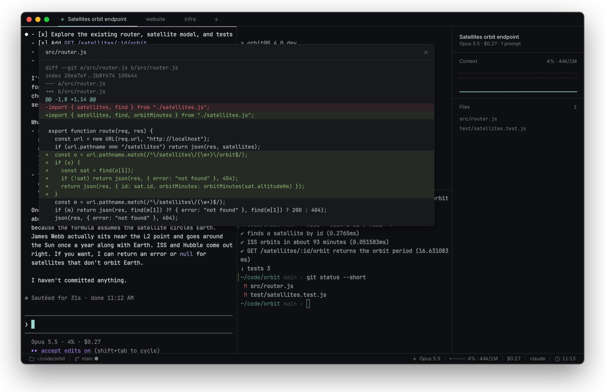

Connect once from Settings → Claude. It adds hooks to `~/.claude/settings.json`, keeps a backup, and Disconnect restores the file exactly. Without hooks, Nacre still finds sessions by their process and transcript. [More](docs/claude.md)

## AI in the shell

<kbd>⌘K</kbd> turns a sentence into a command. You read it, then insert or run it.

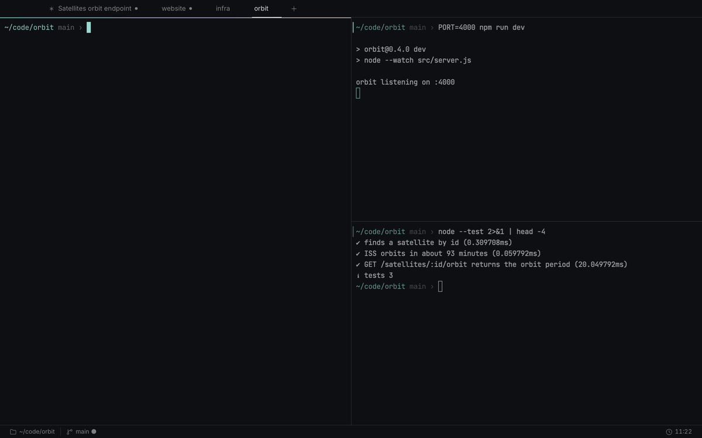

- **Explain error** <kbd>⇧⌘E</kbd> on the last failed command, with a fix you can insert.
- **Suggest fix** <kbd>⌥⌘F</kbd>, **summarize output**, and a **chat panel** <kbd>⇧⌘A</kbd> that can see the folder, the last command or the screen.

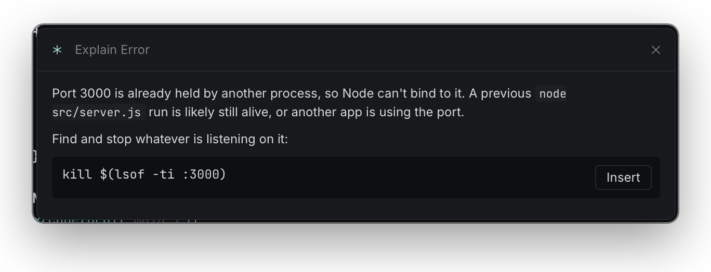

It runs `claude -p` with your Claude Code login and no tools, so nothing executes without you. An Anthropic API key, kept in the Keychain, works too.

## Tabs and splits

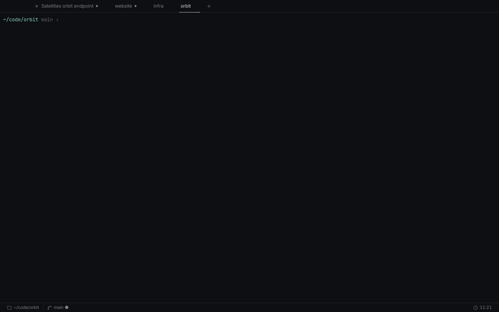

- Split right <kbd>⌘D</kbd> or down <kbd>⇧⌘D</kbd>, move with <kbd>⌥⌘</kbd> + arrows, zoom a pane <kbd>⇧⌘↩</kbd>. New panes open in the current folder.
- **Session restore**: windows, tabs, splits, folders and scrollback come back after a restart.
- **Workspaces**: a TOML file that opens a project's tabs, splits and commands in one go. [Format](docs/workspaces.md)
- Tabs on top or in a sidebar, an overview of all tabs <kbd>⇧⌘\\</kbd>, tabs moved between windows with their shells still running, broadcast input <kbd>⌥⌘I</kbd>, a drop-down terminal on a global shortcut.

## Shell integration

zsh, bash and fish report each command to Nacre, without touching your dotfiles.

- A mark per command in the margin, failed or not. Jump between prompts with <kbd>⌘↑</kbd> <kbd>⌘↓</kbd>, copy the last output <kbd>⇧⌘O</kbd>, rerun it, filter it, keep its command pinned while you scroll.
- Duration and exit code in the status bar, a notification when a long command ends.
- **Completions** <kbd>⌃Space</kbd> for git, npm, docker, cargo, kubectl, brew and gh, and suggestions from your history <kbd>→</kbd>.
- **History**, **folders**, **snippets** and **SSH hosts** in one palette <kbd>⇧⌘H</kbd> <kbd>⇧⌘J</kbd> <kbd>⇧⌘S</kbd> <kbd>⇧⌘R</kbd>.
- **Hints** <kbd>⇧⌘U</kbd>: a letter on every URL, path and hash on screen. Type it to copy or open. **Copy mode** <kbd>⇧⌘X</kbd> moves through the scrollback like vim.

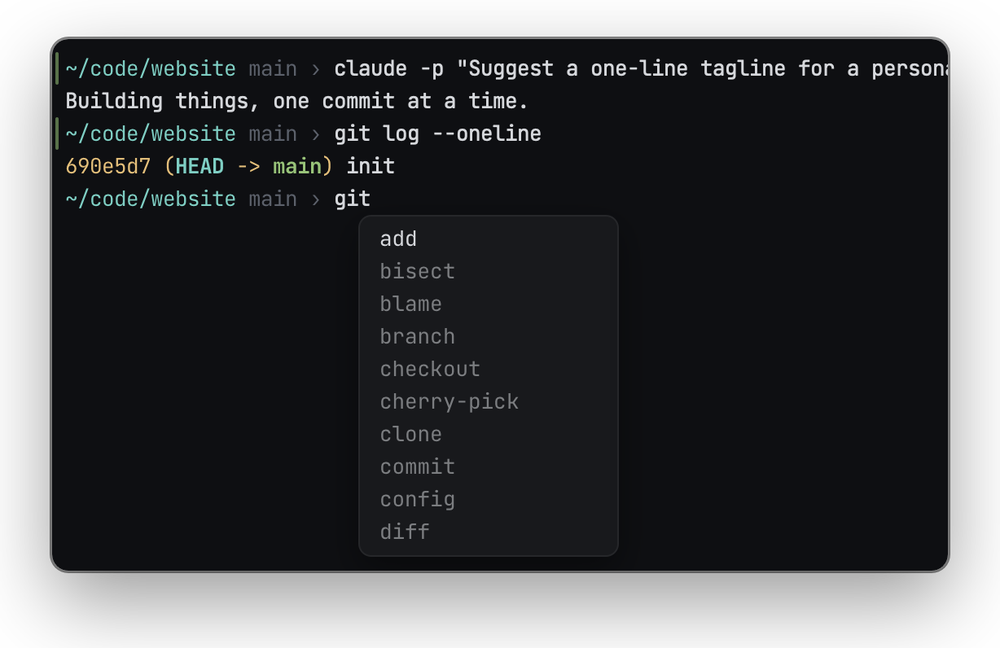
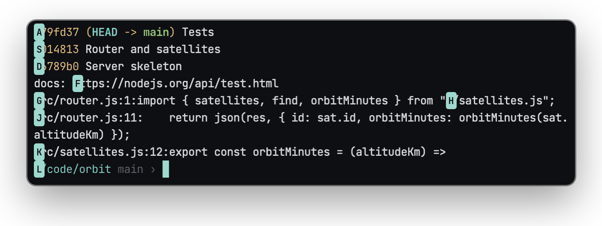

Also: clickable `file:line` paths that open in your editor, inline images (Sixel, iTerm2), secrets masked in the output, session recording to asciinema, clipboard history <kbd>⇧⌘V</kbd>.

## Make it yours

21 themes, plus an editor and importers for iTerm2, Base16, Windows Terminal, Ghostty and Alacritty. Right-click a tab to give it its own theme.

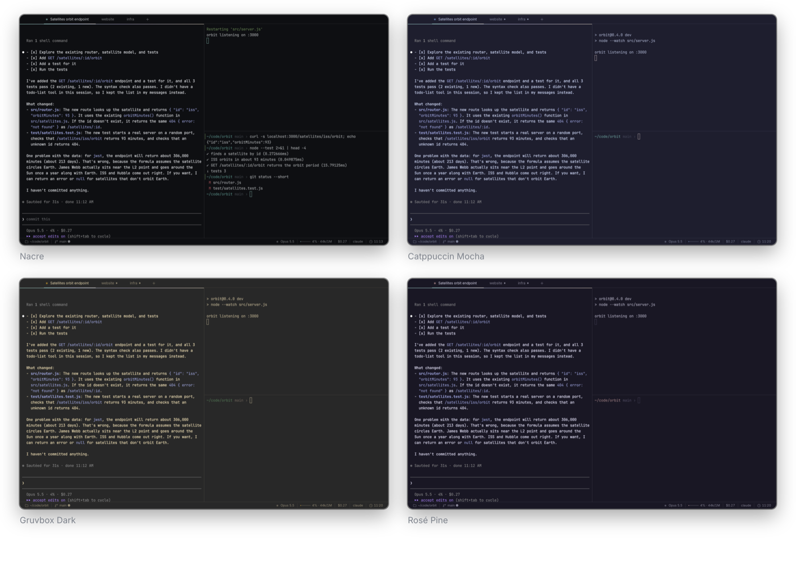

The status bar takes any segments, in four styles: folder, git, process, CPU, memory, battery, tool versions, Kubernetes, AWS, Docker, Claude, or the output of your own script.

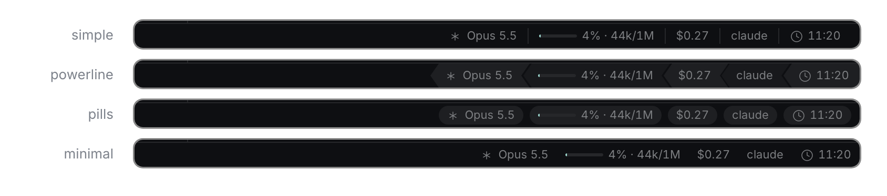

Settings <kbd>⌘,</kbd> and `~/.config/nacre/config.toml` stay in sync, comments included. Every shortcut can be rebound, chords too. Profiles change shell, folder, theme or font per folder or SSH host. JavaScript plugins add segments, commands, themes and triggers.

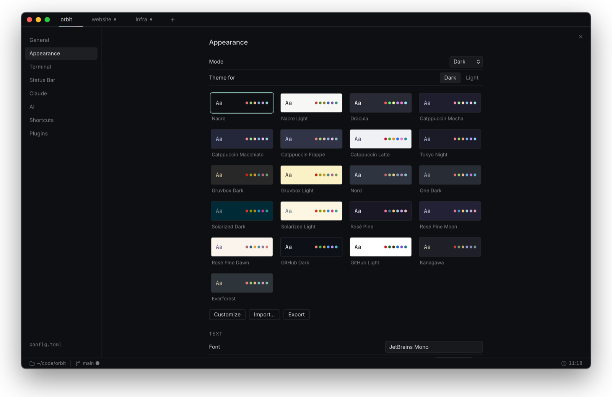

## Install

Download the `.dmg` for your Mac from [Releases](https://github.com/R-Luca06/Nacre/releases) and drag Nacre to Applications. Builds are not notarized yet, so macOS blocks the first launch: open System Settings → Privacy & Security → Open Anyway, or run `xattr -cr /Applications/Nacre.app` once. Updates then install from the app.

No release yet? Build it: `npm install && npm run bundle`, then open the `.dmg` in `target/release/bundle/dmg`.

Requires macOS 12 or later.

## Essentials

|                                |                          |
| ------------------------------ | ------------------------ |
| <kbd>⇧⌘P</kbd>                 | Every action, searchable |
| <kbd>⌘T</kbd> / <kbd>⌘W</kbd>  | New tab / close pane     |
| <kbd>⌘D</kbd> / <kbd>⇧⌘D</kbd> | Split right / down       |
| <kbd>⌘K</kbd>                  | Command from a sentence  |
| <kbd>⇧⌘C</kbd>                 | Claude sessions          |
| <kbd>⌘F</kbd>                  | Find                     |
| <kbd>⌘,</kbd>                  | Settings                 |

All of them: [docs/shortcuts.md](docs/shortcuts.md)

## Docs

[Configuration](docs/config.md) · [Shortcuts](docs/shortcuts.md) · [Claude Code](docs/claude.md) · [Workspaces & profiles](docs/workspaces.md) · [Themes](docs/themes.md) · [Plugins](docs/plugins.md) · [CLI](docs/cli.md) · [Releases](docs/release.md) · [Design](docs/design.md)

## Build

```sh
npm install
npm run dev      # app with hot reload
npm run test     # Vitest + cargo test
npm run lint     # ESLint, Prettier, rustfmt, clippy
npm run bundle   # .app and .dmg in target/release/bundle
```

Requires Node 20+ and Rust. Built with Tauri 2, React, xterm.js and portable-pty.
